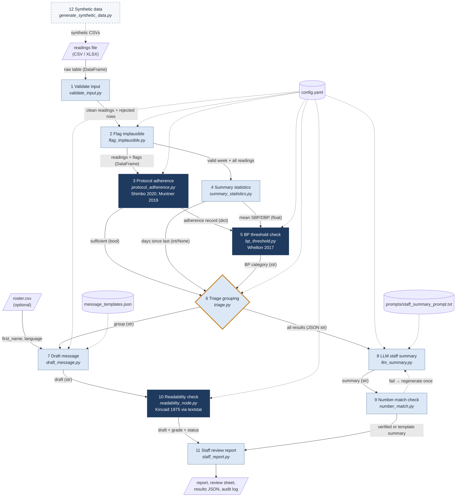

# Open BP Review Assistant

[](https://github.com/ntselha/open-bp-review-assistant/actions/workflows/tests.yml)

An open-source, device-agnostic prototype that turns a weekly home blood pressure monitoring file into a staff-reviewed care-team summary and template-based follow-up message drafts. It is aimed at safety-net clinics, community health worker programs, and small practices that collect readings on paper, by text, or in spreadsheets. Final project for EPID 695/895, Agentic AI in Healthcare and Public Health.

## What it does

1. Checks each patient's readings against the AHA/AMA home monitoring protocol (Shimbo et al., 2020): two readings at least one minute apart, morning and evening, for at least 3 days and ideally 7.
2. Sorts patients into four outreach groups. Missing data is checked first, so a patient who stops reporting never looks like they're doing well:
   1. **No recent readings**
   2. **Too few readings to interpret**
   3. **Above threshold**: mean home BP of 130/80 or higher by default (Whelton et al., 2017)
   4. **Routine**
3. Fills an approved message template for each patient and checks its reading level (Flesch-Kincaid).
4. Writes a short staff summary. With an API key, Claude writes it and every number is checked against the data. Without a key, a plain template summary is used.
5. Produces a staff report and a review sheet. **Staff approve or edit every draft. The tool never diagnoses, recommends treatment, or contacts patients.**

## Quick start

```bash
python -m venv .venv
.venv\Scripts\activate            # Mac: source .venv/bin/activate
pip install -r requirements.txt

python run_workflow.py            # whole workflow on the synthetic data
```

Then open `output/staff_review_report.html` in a browser.

To use your own files:

```bash
python run_workflow.py --input readings.csv --roster roster.csv --out output
```

### Input

| File | Columns |
|---|---|
| Readings (CSV or XLSX) | `patient_id`, `reading_datetime` (for example `2026-11-15 07:40:00`), `systolic`, `diastolic` |
| Roster (CSV, optional) | `patient_id`, `first_name`, `preferred_language`. Catches enrolled patients who sent no readings at all. |

### Output (`output/`, not committed)

| File | Contents |
|---|---|
| `staff_review_report.html` | Weekly report sorted by outreach group, with each patient's numbers, flags, and draft message |
| `review_sheet.csv` | One row per patient, with blank `approve (Y/N)`, `edited_message`, and `reviewer_initials` columns |
| `patient_results.json` | Everything computed for each patient |
| `audit_log.json` | Settings, package versions, rejected input rows, and how the staff summary was produced |

### Settings

Programs change `config.yaml`, not the code: clinic name and phone, review window, no-reading cutoff, protocol minimums, BP threshold, plausibility ranges, readability target, and LLM model. Patient message wording is in `message_templates.json`.

## Wire diagram

Dark boxes are atomic protocols (citable, maintained by others), light boxes are disposable components (built by me), the orange diamond is the decision node, and the dashed box is the test fixture. Source: [`docs/wire_diagram.mmd`](docs/wire_diagram.mmd). The original Session 5 diagram is in [`docs/OpenBP_wire_diagram_Tselha.pdf`](docs/OpenBP_wire_diagram_Tselha.pdf).



## Repository layout

```
run_workflow.py              glue: runs every component in order (see WORKFLOW.md)
openbp/                      one module per wire-diagram component
  validate_input.py          1  disposable
  flag_implausible.py        2  disposable
  protocol_adherence.py      3  atomic protocol (Shimbo 2020; Muntner 2019)
  summary_statistics.py      4  disposable
  bp_threshold.py            5  atomic protocol (Whelton 2017)
  triage.py                  6  disposable, decision node
  draft_message.py           7  disposable
  llm_summary.py             8  disposable prompt + versioned LLM
  number_match.py            9  disposable
  readability_node.py        10 atomic protocol (Kincaid 1975 via textstat)
  staff_report.py            11 disposable
generate_synthetic_data.py   12 test fixture
tests/                       one test file per component + end-to-end test
config.yaml                  settings
message_templates.json       approved patient message templates
prompts/                     LLM prompt
data/                        synthetic readings and roster
docs/                        wire diagram, readability contract
WORKFLOW.md                  instructions for regenerating the glue
```

## Synthetic data

All data in this repository is synthetic. `generate_synthetic_data.py` builds patients from six patterns, each designed to land in a known group:

| Pattern | Readings | Expected group |
|---|---|---|
| `regular_controlled` | Morning and evening, 2 readings each, every day, about 118/74 | Routine |
| `regular_high` | Same schedule, about 146/92 | Above threshold |
| `sparse` | Only 2 days this week | Too few readings |
| `stopped` | Readings 2 to 3 weeks ago, then nothing | No recent readings |
| `never_reported` | On the roster, no readings | No recent readings |
| `implausible` | Like `regular_controlled`, plus typos (1400/80, 70/110) | Routine, typos flagged |

It also adds a duplicate row, a bad date, and a non-numeric value for the validator to reject, and marks one patient as preferring Spanish.

```bash
python generate_synthetic_data.py                        # 2 per pattern, seed 42
python generate_synthetic_data.py --per-pattern 5 --seed 7 --end-date 2026-12-06
```

The same seed always produces the same file.

## Optional: LLM staff summary

```bash
pip install -r requirements-llm.txt
set ANTHROPIC_API_KEY=your-key       # Mac: export ANTHROPIC_API_KEY=your-key
python run_workflow.py
```

The model ID is set in `config.yaml` (`llm.model`). The prompt tells the model to use only the numbers given and never to interpret results clinically. The number-match check rejects any summary containing a number that isn't in the data. It regenerates once, then falls back to the template summary. Never commit your API key.

## Tests

```bash
python -m pytest -v
```

Every component has its own test file in `tests/`, and `test_end_to_end.py` runs the whole workflow on synthetic data and checks that every patient lands in its expected group. The LLM tests use a fake client, so no API calls are made. GitHub Actions runs all tests and the full workflow on every push and every Monday.

### Expected failures (xfail)

Two tests describe known limitations. They are marked `xfail(strict=True)`: they are expected to fail, and if a future change fixes the limitation, the test will start passing and alert us to update this section.

| Test | Limitation | Mitigation |
|---|---|---|
| `test_flag_implausible.py::test_catches_in_range_typo` | Range rules can't catch a typo that stays in range, such as 151 entered instead of 115. | Staff see every patient's mean and can check unusual values. |
| `test_number_match.py::test_catches_number_attributed_to_wrong_patient` | The number-match check confirms each number exists in the data, not that it belongs to the patient named next to it. | The summary is advisory. Each patient's own numbers appear in the report table. |

## Limitations

- **English only.** Message templates are English only. Patients with another preferred language are flagged for translation, and the Flesch-Kincaid check applies to English text only.
- **Readings are trusted as entered.** Timing relative to medication and measurement technique can't be checked from a readings file.
- **Not clinically validated.** Thresholds and protocol rules come from the cited statements and can be set per program. This is a prototype tested on synthetic data only.

## References

- Kincaid JP, Fishburne RP, Rogers RL, Chissom BS. *Derivation of New Readability Formulas for Navy Enlisted Personnel.* Research Branch Report 8-75. Naval Technical Training Command; 1975.
- Muntner P, Shimbo D, Carey RM, et al. Measurement of blood pressure in humans: a scientific statement from the American Heart Association. *Hypertension.* 2019;73(5):e35–e66.
- Shimbo D, Artinian NT, Basile JN, et al. Self-measured blood pressure monitoring at home: a joint policy statement from the American Heart Association and American Medical Association. *Circulation.* 2020;142(4):e42–e63.
- Whelton PK, Carey RM, Aronow WS, et al. 2017 ACC/AHA/AAPA/ABC/ACPM/AGS/APhA/ASH/ASPC/NMA/PCNA guideline for the prevention, detection, evaluation, and management of high blood pressure in adults. *Hypertension.* 2018;71(6):1269–1324.

## Final project checklist

- [x] Workflow runs end to end with one command
- [x] Every wire-diagram component is in the code
- [x] Unit tests pass in GitHub Actions
- [x] Each component is its own module (`openbp/`)
- [x] Mermaid wire diagram matching the code
- [x] Unit test for every atomic protocol and disposable component, run in GitHub Actions; xfails described above
- [x] `WORKFLOW.md` instructions for regenerating the glue
- [x] Dependency file with pinned versions
- [x] README covering what the workflow does and how to set it up and run it
