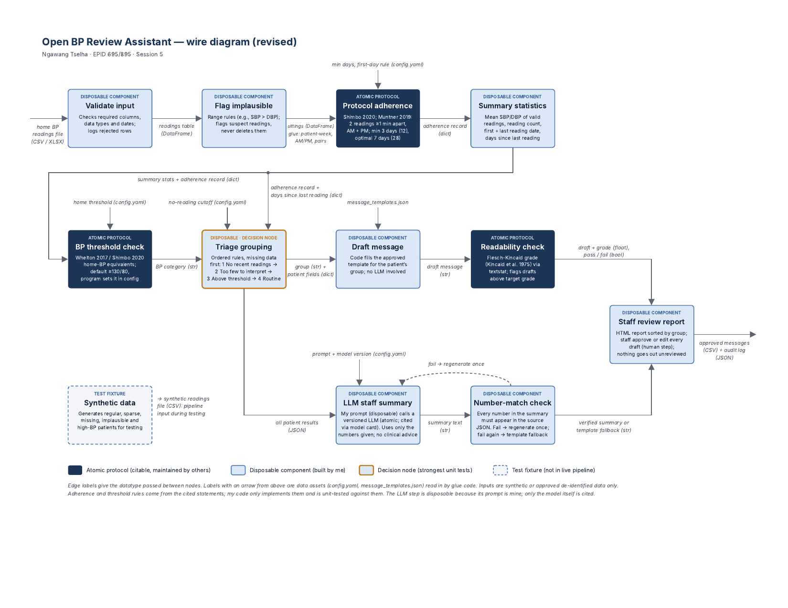

# Open BP Review Assistant

[](https://github.com/ntselha/open-bp-review-assistant/actions/workflows/tests.yml)

An open-source, device-agnostic prototype that turns a weekly home blood pressure monitoring file into a staff-reviewed care-team summary and template-based follow-up message drafts. It is aimed at under-resourced programs that collect readings on paper, by text, or in spreadsheets. Final project for EPID 695/895, Agentic AI in Healthcare and Public Health.

The tool checks whether each patient's readings meet the AHA/AMA home monitoring protocol, treats missing readings as a reason for outreach, and sorts patients into four groups: no recent readings, too few readings to interpret, above threshold, and routine. **It never diagnoses, recommends treatment, or contacts patients.** Staff review every draft.

## Wire diagram

The readability check (Flesch-Kincaid grade via textstat) sits between the Draft message node and the Staff review report: it scores each templated draft and flags any above the target grade for staff review.



## Quick start

```bash
python -m venv .venv
.venv\Scripts\activate            # Mac: source .venv/bin/activate
pip install -r requirements.txt

python run_workflow.py            # runs the whole workflow on the synthetic data
```

Then open `output/staff_review_report.html` in a browser.

To use a different readings file: `python run_workflow.py --input path/to/readings.csv --roster path/to/roster.csv`

## Input

| File | Columns |
|---|---|
| Readings (CSV or XLSX) | `patient_id`, `reading_datetime` (e.g. `2026-11-15 07:40:00`), `systolic`, `diastolic` |
| Roster (CSV, optional) | `patient_id`, `first_name`, `preferred_language`. Lets the tool catch enrolled patients who sent no readings at all. |

## Output (in `output/`, not committed)

| File | What it is |
|---|---|
| `staff_review_report.html` | Weekly report for staff, sorted by outreach group, with each patient's draft message |
| `review_sheet.csv` | One row per patient with blank `approve (Y/N)`, `edited_message`, and `reviewer_initials` columns |
| `patient_results.json` | Everything computed for each patient |
| `audit_log.json` | Settings, package versions, rejected input rows, and how the staff summary was produced |

## Synthetic data

All data in this repository is synthetic. `generate_synthetic_data.py` creates one patient per pattern so that every triage path is tested:

| Pattern | Readings | Expected group |
|---|---|---|
| `regular_controlled` | Morning and evening, 2 readings each, every day, about 118/74 | Routine |
| `regular_high` | Same schedule, about 146/92 | Above threshold |
| `sparse` | Only 2 days this week | Too few readings |
| `stopped` | Readings 2 to 3 weeks ago, then nothing | No recent readings |
| `never_reported` | On the roster, no readings | No recent readings |
| `implausible` | Like `regular_controlled`, plus typos (1400/80, 70/110) | Routine, typos flagged |

It also adds a duplicate row, a bad date, and a non-numeric value so the validator has something to reject, and marks one patient as preferring Spanish.

```bash
python generate_synthetic_data.py                       # default: 2 per pattern, seed 42
python generate_synthetic_data.py --per-pattern 5 --seed 7 --end-date 2026-12-06
```

The same seed always produces the same file.

## Components

All components are in `run_workflow.py`, one numbered section per wire-diagram node. Settings are in `config.yaml`, patient message wording in `message_templates.json`, and the LLM prompt in `prompts/staff_summary_prompt.txt`.

| # | Component | Type | Source |
|---|---|---|---|
| 1 | Validate input | Disposable | |
| 2 | Flag implausible | Disposable | |
| 3 | Protocol adherence | Atomic protocol | Shimbo et al. (2020); Muntner et al. (2019) |
| 4 | Summary statistics | Disposable | |
| 5 | BP threshold check | Atomic protocol | Whelton et al. (2017); default home-BP threshold 130/80, set in config |
| 6 | Triage grouping | Disposable (decision node) | |
| 7 | Draft message | Disposable | Approved templates; no LLM |
| 8 | LLM staff summary | Disposable prompt + versioned LLM | Claude (`claude-haiku-5-5`), only if `ANTHROPIC_API_KEY` is set |
| 9 | Number-match check | Disposable | Regenerates once, then falls back to a template summary |
| 10 | Readability check | Atomic protocol | Kincaid et al. (1975) via textstat 0.7.4 (`readability_node.py`) |
| 11 | Staff review report | Disposable | |
| 12 | Synthetic data | Test fixture | `generate_synthetic_data.py` |

### Optional: LLM staff summary

Without an API key, the workflow uses the template summary. To try the LLM step:

```bash
pip install -r requirements-llm.txt
set ANTHROPIC_API_KEY=your-key      # Mac: export ANTHROPIC_API_KEY=your-key
python run_workflow.py
```

Never commit your API key.

## Run the tests

```bash
python -m pytest -v
```

- `test_flesch_kincaid_grade_level.py`: readability protocol (Session 6)
- `test_workflow.py`: triage decision rules, threshold boundaries, number-match check, validator, plausibility flags, and an end-to-end run checking that every synthetic patient lands in its expected group

Tests run automatically in GitHub Actions on every push.

## Progress toward the final version

- [x] Workflow runs end to end with one command
- [x] Every wire-diagram component is in the code
- [x] Unit tests pass in GitHub Actions
- [ ] Each component in its own module
- [ ] Mermaid wire diagram matching the code
- [ ] Unit test for every atomic protocol and disposable component
- [ ] `WORKFLOW.md` instructions for regenerating the glue code
- [x] Dependency file with pinned versions
- [x] README covering what the workflow does and how to run it
